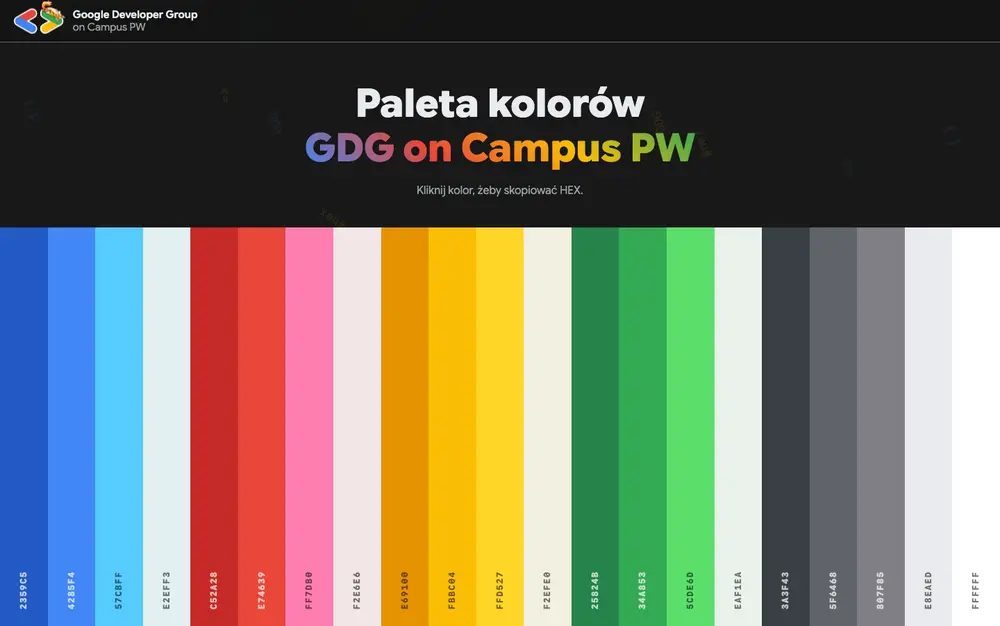
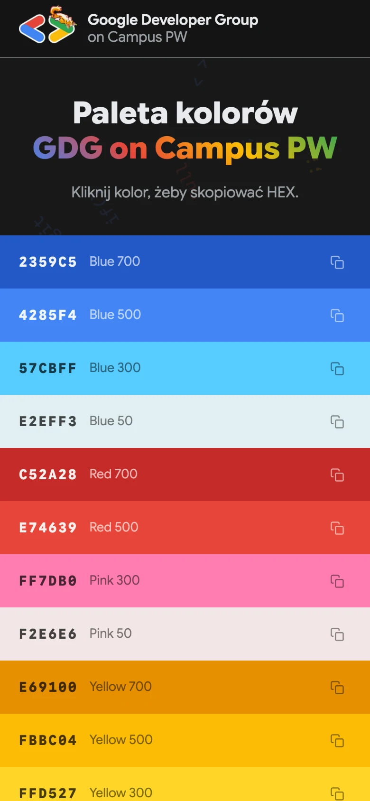

  

  <h1>Paleta kolorów GDG</h1>
  
Kolory GDG on Campus PW na jedno kliknięcie.

  

    

  
  
  
  
  

---

  
   Najedź na pasek, żeby zobaczyć nazwę. Kliknij, a HEX ląduje w schowku.

 

Dla Marketing Team i każdego, kto robi grafikę, slajdy albo stronę w barwach koła. Bez szukania kodów po starych plikach.

---

## 🎨 Paleta

| | |
|--|--|
| **Blue** |     |
| **Red** |   |
| **Pink** |   |
| **Yellow** |     |
| **Green** |     |
| **Gray** |     |
| **White** |  |

---

## 📱 Na telefonie

  

Na telefonie paski układają się poziomo, z kodem i nazwą od razu na wierzchu.

---

## Pod maską

- Czysty HTML, CSS i JS. Bez buildów i zależności.
- Kolory są w `js/data.js`. Po zmianie palety warto podmienić też pasek kolorów w `assets/og.jpg`, czyli obrazku podglądu linku.
- Paski to przyciski, więc działa Tab + Enter. Na tabletach bez myszki nazwy widać od razu.
- Bez HTTPS (np. adres IP w sieci lokalnej) kopiowanie przechodzi na starszy sposób i dalej działa.
- Lokalnie: `python3 -m http.server` albo `docker compose up --build` i http://localhost:8097.
- Easter egg: `↑ ↑ ↓ ↓ ← → ← → B A`.

---

  <a href="https://gdg.community.dev/gdg-on-campus-politechnika-warszawska-warsaw-poland/">GDG on Campus PW</a> &nbsp;·&nbsp; <a href="https://colors.gdgpw.pl">colors.gdgpw.pl</a>

